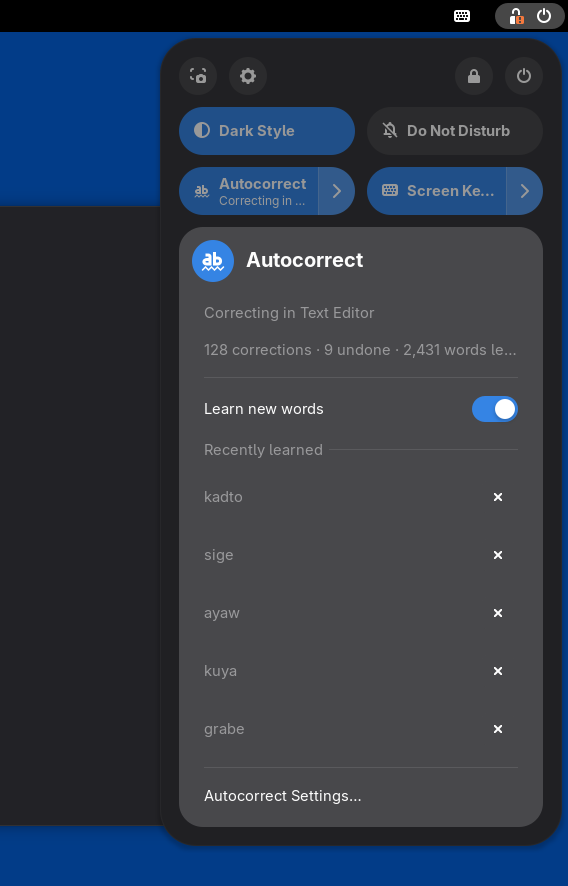
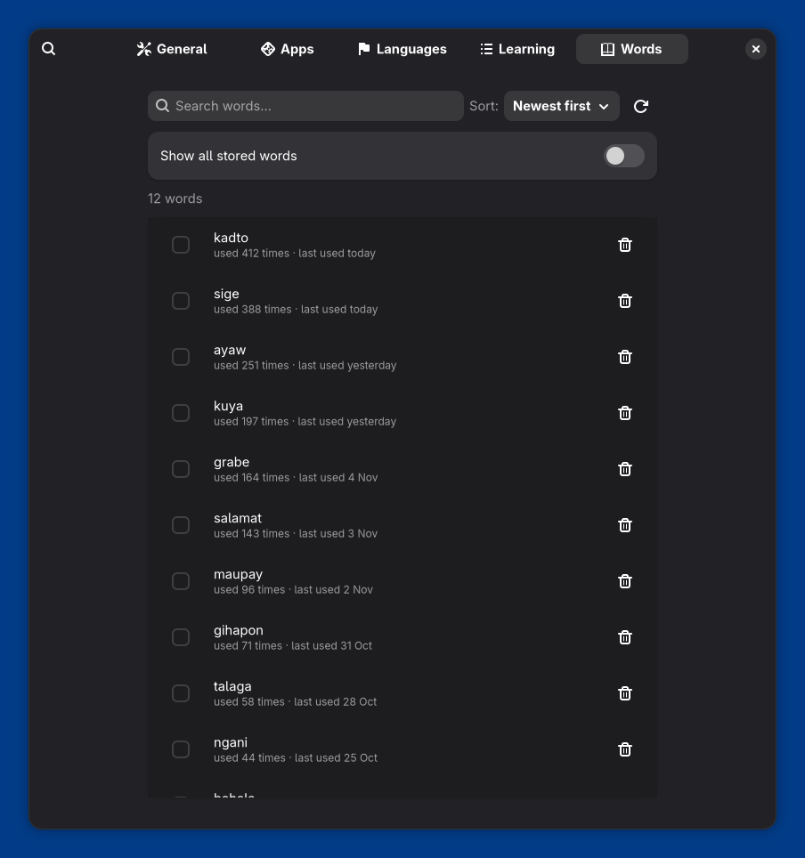
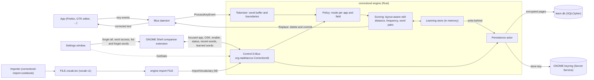
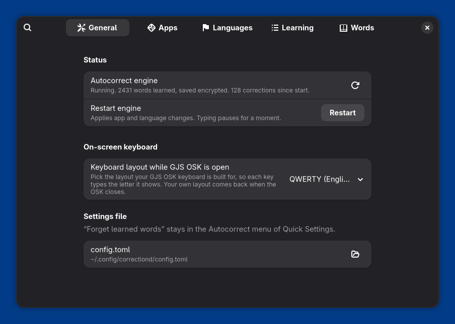
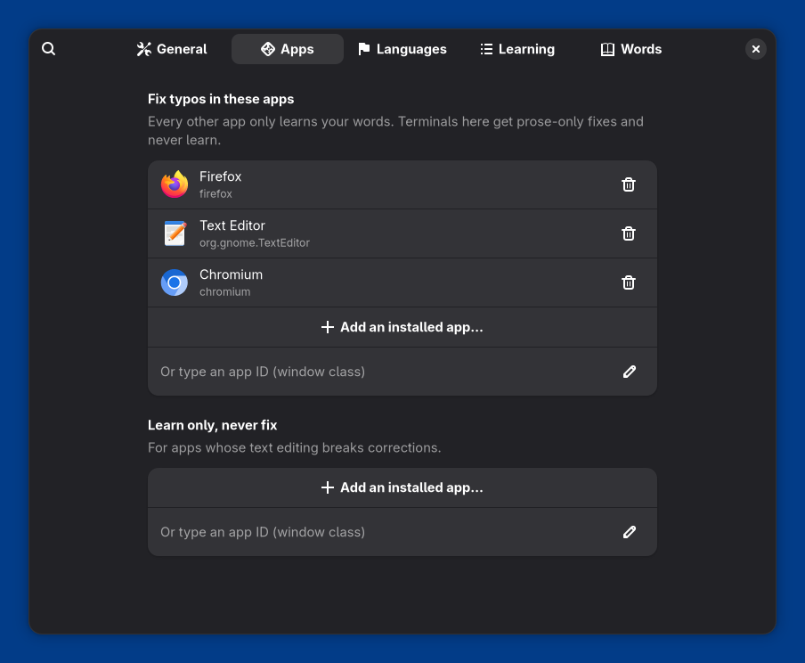
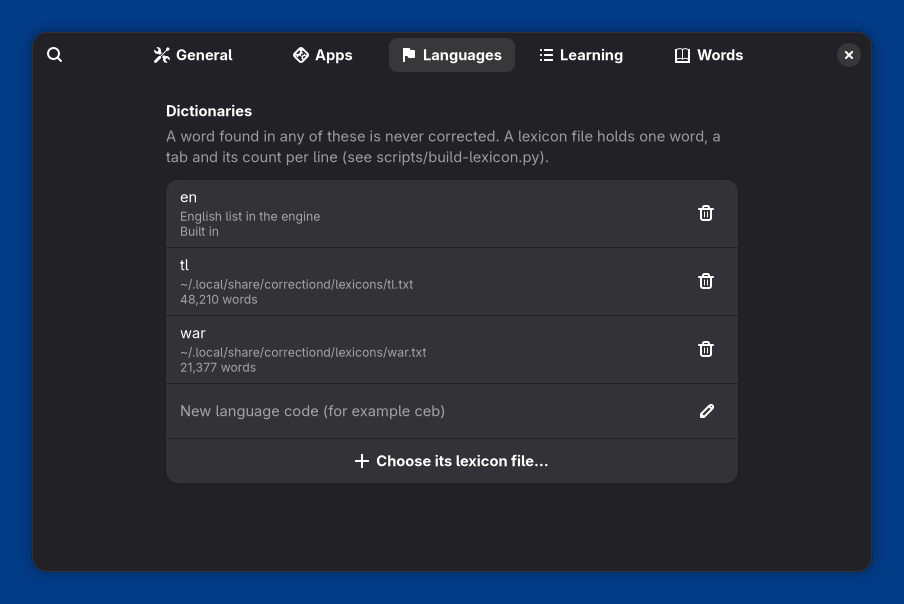
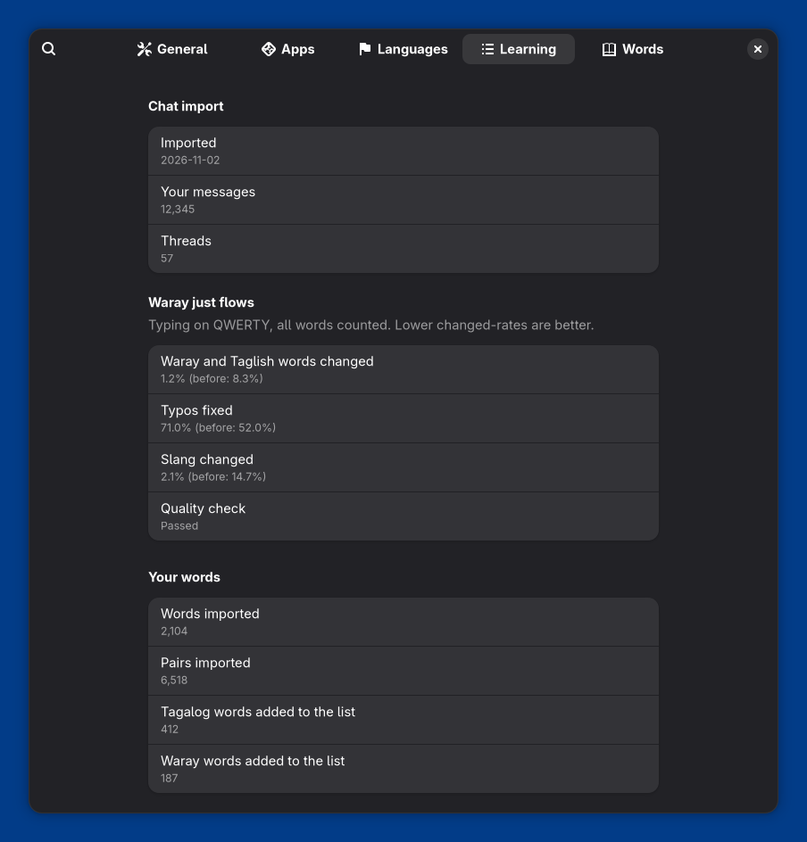
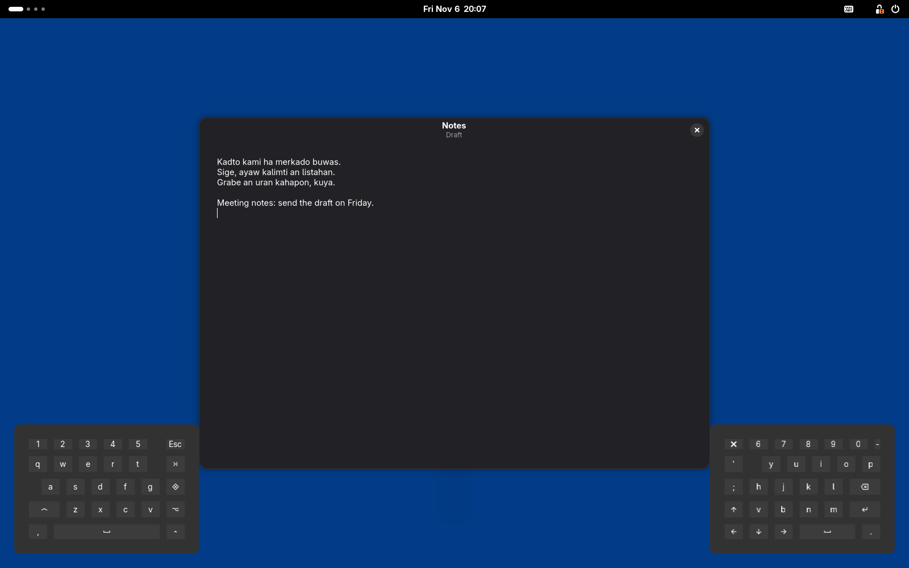

# correctiond

[](https://github.com/nadelacruz-00/correctiond/actions/workflows/ci.yml)

correctiond is a local autocorrect for GNOME on Wayland. It is an IBus input
engine written in Rust: it watches what you type, and when a word ends with a
space or punctuation it silently replaces a likely typo, the way a phone
keyboard does. It knows which keyboard layout you type on (Colemak or US
QWERTY, or GJS OSK's on-screen keys), learns your own words so it stops
"fixing" them, and backs off for good when you undo a fix. A small GNOME Shell
extension tells it which app has focus and adds a Quick Settings menu and a
Settings window.

**Privacy:** nothing leaves your machine. There is no network code. What it
learns is kept in an encrypted database whose key lives in your GNOME login
keyring.

<p align="center">
  
  &nbsp;
  
</p>

## Features

- Silent correction at word boundaries; no popups or suggestion lists.
- Two input sources: `correctiond:colemak` and `correctiond:us`. Typo costs
  follow the physical key layout, and switch to on-screen keyboard geometry
  while GJS OSK is open.
- One Backspace right after a fix undoes it, and that fix is never made again.
- Learns your vocabulary, word pairs and your own slip patterns. A word is
  saved once it has been seen twice.
- Corrects only in apps you allowlist (Firefox by default). Every other app
  is learn-only.
- Never corrects or learns in password, PIN, email, URL, number or private
  fields. Terminals are off unless allowlisted, and then get prose-only fixes
  and never learn.
- Several languages: English is built in. Tagalog and Waray lexicons can be
  built from public frequency lists, and any language can be added as a word
  list. Corrections stay within the language you are writing in.
- Encrypted learning store (SQLCipher, AES-256) with the key in the Secret
  Service keyring. It never prompts; if the keyring is locked, learning stays
  in memory until it unlocks.
- Quick Settings menu: on/off, app status, counts, a "Learn new words" pause
  switch, and recently learned words you can forget.
- Settings window: apps, languages, on-screen keyboard layout, chat import
  report, "Forget all learned words", and a Words page to search, sort and
  forget learned words (behind a Shell approval prompt).
- Imports word counts from other sources in a documented file format.

## How it works



The app sends keys to the IBus daemon, which hands each one to the engine. The
engine lets keys through to the app and keeps its own copy of the word being
typed. At a word boundary it decides, from the app and the field type,
whether it may correct; if so, it scores candidates with a layout-aware edit
distance plus word frequency and your own vocabulary, and when one candidate
clearly wins it asks the app to delete the typed word and commits the fix.
Learning happens in memory on the typing path and is written to the encrypted
database in the background every 30 seconds. Only GNOME Shell, through the
extension, may change the engine's settings or read learned words; see
[docs/ARCHITECTURE.md](docs/ARCHITECTURE.md) for the full picture.

## Requirements

- GNOME Shell 50 on Wayland (the extension's `shell-version` is `["50"]`).
- IBus, as GNOME's input method framework (the `ibus` command must be
  available).
- A stable Rust toolchain with Cargo (CI uses the current stable release;
  edition 2021).
- Build libraries: SQLCipher is bundled and compiled from source, and links
  against the system OpenSSL `libcrypto`. On Debian or Ubuntu:
  `sudo apt-get install -y libssl-dev pkg-config` (plus a C compiler).
- A Secret Service keyring in the session, normally gnome-keyring with the
  login keyring unlocked at login.
- Python 3, only to build extra language lexicons.
- Optional: the GJS OSK extension (`gjsosk@vishram1123.com`) for on-screen
  keyboard support.

## Install

These steps install from source for the current user. Only step 3 needs sudo.

1. **Get the source.**

   ```sh
   git clone https://github.com/nadelacruz-00/correctiond.git
   cd correctiond
   ```

2. **Build.**

   ```sh
   cargo build --release
   ```

   This produces `target/release/engine`, the IBus engine and the `import`
   client in one binary.

3. **Install the IBus component.**

   ```sh
   scripts/install-dev.sh
   ```

   The script asks for sudo, writes `/usr/share/ibus/component/correctiond.xml`
   with its `<exec>` pointing at your `target/release/engine`, and runs
   `ibus restart`. Run it again after moving the checkout. You don't need to
   rerun it after a rebuild; run `ibus restart` instead.

4. **Add the input source.** Open GNOME Settings, Keyboard, Input Sources, add
   an input source, choose English, then "English (Colemak, autocorrect)" or
   "English (US, autocorrect)". They replace your plain Colemak or US layout,
   and Super+Space switches between them as usual. To select one from a
   terminal for a quick test:

   ```sh
   ibus engine correctiond:colemak
   ```

5. **Install the companion extension.**

   ```sh
   scripts/install-extension.sh
   ```

   This copies the extension to
   `~/.local/share/gnome-shell/extensions/correctiond-companion@nadelacruz-00.github.io/`.
   GNOME Shell on Wayland loads new extensions only at login, so log out and
   back in, then enable it in the Extensions app or with:

   ```sh
   gnome-extensions enable correctiond-companion@nadelacruz-00.github.io
   ```

   Without the extension the engine cannot tell which app has focus, so it
   only learns and never corrects.

6. **First run and the keyring.** On its first start with the login keyring
   unlocked, the engine creates one keyring item, "Correctiond learning store
   key", and an encrypted `~/.local/share/correctiond/learn.db`. It never shows
   a password prompt. If the keyring is locked, typing and corrections work
   normally, learning stays in memory, and the store attaches once the keyring
   is unlocked.

7. **Optional: Tagalog and Waray lexicons.** These are never shipped. Without
   them, Tagalog and Waray words can be corrected into English, and the
   journal shows `correctiond: WARNING: no lexicon for language ...` at
   startup. Download the Leipzig Corpora Collection `*-words.txt` files for
   each language (<https://wortschatz.uni-leipzig.de/en/download>), then run
   from the repo root:

   ```sh
   python3 scripts/build-lexicon.py --lang tl  --freq tgl_*-words.txt --freq-format leipzig --out ~/.local/share/correctiond/lexicons/tl.txt
   python3 scripts/build-lexicon.py --lang war --freq war_*-words.txt --freq-format leipzig --out ~/.local/share/correctiond/lexicons/war.txt
   ```

   The engine reads `~/.local/share/correctiond/lexicons/<code>.txt` by
   default. Lexicons load when the engine starts, so restart it afterwards
   (Settings, General, Restart engine, or `ibus restart`). See
   [docs/configuration.md](docs/configuration.md#languages) to add other
   languages.

### Uninstall

1. In the extension's Settings window, Learning page, choose "Forget all
   learned words". This deletes the database and the keyring item.
2. Remove the input sources in GNOME Settings, Keyboard.
3. Remove the extension and the IBus component:

   ```sh
   gnome-extensions disable correctiond-companion@nadelacruz-00.github.io
   rm -r ~/.local/share/gnome-shell/extensions/correctiond-companion@nadelacruz-00.github.io
   sudo rm /usr/share/ibus/component/correctiond.xml
   ibus restart
   ```

4. Optionally remove the remaining files: `~/.config/correctiond/` (settings)
   and `~/.local/share/correctiond/` (lexicons and the import report).

## Usage

**Typing.** Type as usual in an allowlisted app. When you finish a word with a
space or `, ; : ! ?` (or Enter or Tab), a typo is replaced if one correction is
clearly better than the rest. Words in any loaded lexicon, and words you have
typed at least twice, are never changed. ALL-CAPS and mixed-case words, words
with digits or symbols, and words shorter than 3 letters are left alone.

**Undo a fix.** Press Backspace right after a correction. The original word
and the boundary character come back, and that correction is never made
again. Any other key first closes the undo window; after that, Backspace
deletes as usual. A fix made at Enter or Tab has no undo window.

**Quick Settings.** The Autocorrect toggle turns correction and learning on
or off. Its menu shows whether the focused app is corrected, learn-only or
off and why, the counts of corrections, undone corrections and learned words,
a "Learn new words" switch to pause learning (until the engine restarts), the
five most recently learned words with a ✕ to forget each one, and "Autocorrect
Settings…".

**Settings window** (Extensions, Correctiond Companion, Settings):

| Page | What it does |
| --- | --- |
| General | Engine status, Restart engine, the layout to use while GJS OSK is open, a link to `config.toml` |
| Apps | "Fix typos in these apps" (the allowlist) and "Learn only, never fix" (apps whose editing breaks corrections) |
| Languages | The configured lexicons, whether each file exists, add or remove a language |
| Learning | The last chat import report and "Forget all learned words…" |
| Words | Search, sort and forget learned words (with a 5-second Undo), after you allow it in a Shell prompt |

App and language changes apply after Restart engine.

<details>
<summary>More screenshots</summary>

| General | Apps |
| --- | --- |
|  |  |
| **Languages** | **Learning** |
|  |  |

Typing with GJS OSK and a split ergonomic layout; correctiond switches to on-screen key geometry while it is open:



All screenshots use invented data and come from `scripts/readme-screenshots.sh`, which runs GNOME Shell headless; see [docs/screenshots/README.md](docs/screenshots/README.md).

</details>

**Import a chat history.** Importers that turn chat exports into word counts
live in [correctiond-import-cookbook](https://github.com/nadelacruz-00/correctiond-import-cookbook).
They write a "correctiond vocab v1" file ([docs/vocab-format.md](docs/vocab-format.md)),
which you hand to the running engine:

```sh
target/release/engine import FILE.vocab.tsv
```

It prints `Imported N words and M word pairs.` on success. The keyring must be
unlocked, and the same file is never imported twice.

## Configuration

The engine reads `~/.config/correctiond/config.toml` when it starts. A missing
or invalid file means defaults. The Settings window edits this file for you.

| Key | Default | Meaning |
| --- | --- | --- |
| `allowlist` | `["firefox"]` | Apps (window class, case-insensitive) where typos are fixed |
| `broken` | `[]` | Apps that only learn, even if allowlisted |
| `osk_source` | unset (acts as `"correctiond:us"`) | Input source while GJS OSK is open; `""` keeps the current one |
| `auto_switch_osk` | `true` | Older form of `osk_source`: `true` means `correctiond:us` |
| `allow_any_caller` | `false` | Debugging only: let any session-bus client call the control interface |
| `[[languages]]` | en (built in), tl, war | `code` and `lexicon` path per language, at most 16 |

```toml
osk_source = "correctiond:us"
allowlist = ["firefox", "org.gnome.TextEditor"]
broken = []

[[languages]]
code = "en"
lexicon = "builtin:en"

[[languages]]
code = "tl"
lexicon = "~/.local/share/correctiond/lexicons/tl.txt"
```

Full reference: [docs/configuration.md](docs/configuration.md).

## Privacy and security

- **What is stored:** words you typed at least twice (with counts and last
  use), adjacent word pairs, your own letter slips per layout, reverted
  corrections, and the hashes of imported files. Only letter-only words of 3
  to 24 characters are learned, in every app except terminals and sensitive
  fields (learn-only apps included). It lives in `~/.local/share/correctiond/learn.db` (directory `0700`, files
  `0600`).
- **Encryption:** SQLCipher with a random 256-bit key. The key is stored only
  as a Secret Service item in your login keyring. There is no plaintext
  fallback. Protection is as strong as your login password.
- **D-Bus callers:** every control method except `GetStats` and
  `ImportVocabulary` is accepted only from GNOME Shell (the owner of
  `org.gnome.Shell`). `GetStats` returns counts only. Reading or bulk-forgetting
  learned words (`ListWords`, `ForgetWords`) is Shell-only even with
  `allow_any_caller`, and the extension passes those calls through only for
  the focused Settings window after you click Allow in a Shell prompt.
- **No network:** the engine talks only to the IBus daemon and the session bus
  over local sockets. Logs hold fixed texts and counts, never typed words.

Details and how to report a vulnerability: [SECURITY.md](SECURITY.md).

## Troubleshooting

1. **Nothing is corrected at all.** Check that an autocorrect source is
   active: `ibus engine` should print `correctiond:colemak` or `correctiond:us`.
   The Settings window's General page says "Not running" otherwise. Check
   `journalctl --user -b | grep correctiond` for startup errors.
2. **The app is not in the allowlist.** The Quick Settings menu says "Not
   correcting in NAME (not in your app list)". Add it in Settings, Apps. The
   class must match the window: Firefox from the snap store is
   `firefox_firefox`, not `firefox`. "App not identified" means the extension
   is not running.
3. **Colemak types as QWERTY.** GNOME Shell 50 ignores an engine's
   `layout_variant`, so the shipped component declares `us+colemak` instead.
   If you installed an older checkout, pull and rerun `scripts/install-dev.sh`.
4. **Learning does not survive a restart.** The keyring is locked or missing:
   the journal shows `correctiond: keyring locked; learning stays in memory`.
   Unlock the login keyring and switch windows; the store attaches within
   seconds. Until then, imports and forgetting words are refused.
5. **Wrong letters with the on-screen keyboard.** Pick the layout your GJS OSK
   keyboard is drawn for in Settings, General, "Keyboard layout while GJS OSK
   is open", and add that input source in GNOME Settings. With per-window
   input sources turned on, the source is not switched.

More: [docs/troubleshooting.md](docs/troubleshooting.md).

## Development

```text
corelib/     Rust library: tokenizer, dictionary, scoring, layouts, policy, learning store, SQLCipher writer
engine/      Rust binary: IBus engine, control D-Bus, keyring, persistence actor, `engine import`
extension/   GNOME Shell companion extension and Settings window (GJS), with tests in extension/test/
data/        IBus component XML, built-in English list, test vectors shared by Rust and JS
scripts/     install, pack, smoke and E2E scripts, lexicon builders
tests/e2e/   IBus client used by scripts/e2e.sh
docs/        formats, architecture, design notes
```

Tests:

| Command | Needs |
| --- | --- |
| `cargo fmt --all --check` | |
| `cargo clippy --workspace --all-targets --locked -- -D warnings` | |
| `cargo test --workspace --locked` | |
| `bash scripts/e2e.sh` | `ibus`, `python3-gi`, `gir1.2-ibus-1.0`, `dbus`; no display |
| `bash scripts/headless-smoke.sh` | same as e2e; no display |
| `python3 -m unittest discover scripts` | |
| `gjs -m extension/test/lib.test.js` | `gjs` |
| `gjs -m extension/test/config.test.js` | `gjs` |
| `gjs -m extension/test/prefs.smoke.js` | a display and libadwaita 1.7 or later |
| `bash scripts/extension-smoke.sh` | `gnome-shell` 50 and GJS OSK installed system-wide; runs headless |
| `cargo test -p engine live_keyring -- --ignored` | your real keyring (creates and deletes a test item) |

The headless scripts use a private session bus, a private IBus daemon and a
temporary `HOME`, so they never touch your desktop or keyring. CI
(`.github/workflows/ci.yml`) runs fmt, test and clippy, then the E2E, the
Python tests and the two plain gjs tests, on Ubuntu 24.04 for x86_64 and
arm64. Tagged releases (`release.yml`) build `.deb` packages with
`cargo deb -p engine` and the extension zip with `scripts/pack-extension.sh`.

See [CONTRIBUTING.md](CONTRIBUTING.md) and [docs/ARCHITECTURE.md](docs/ARCHITECTURE.md).

## Related

- [correctiond-import-cookbook](https://github.com/nadelacruz-00/correctiond-import-cookbook):
  importers that turn chat histories into vocab v1 files.

## License

Licensed under either of [MIT](LICENSE-MIT) or [Apache-2.0](LICENSE-APACHE) at
your option. Copyright (c) 2026 nadelacruz-00.

The built-in English list `data/en_words.txt` is derived from hermitdave
FrequencyWords and is shared under CC-BY-SA-4.0; spellings are checked
against SCOWL. See [data/ATTRIBUTION.md](data/ATTRIBUTION.md) for all data and
library attributions.
