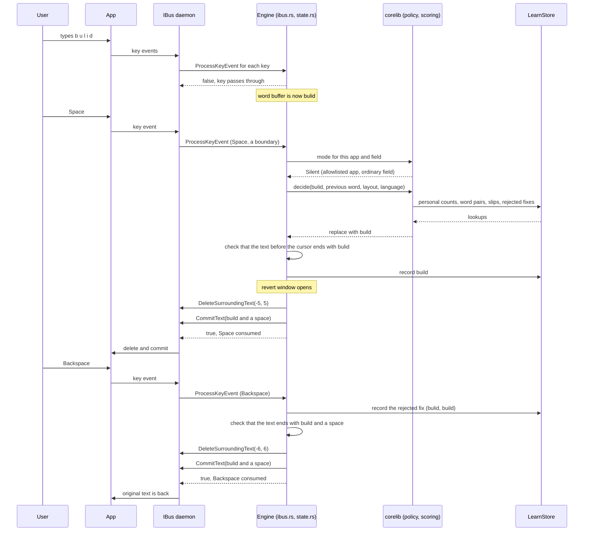

# Architecture

This page describes how correctiond is put together: the processes, the two
Rust crates, the GNOME Shell extension, the D-Bus interfaces between them,
and how learned data is stored. For user-facing behavior see the
[README](../README.md); for settings see [configuration.md](configuration.md).

## Why an IBus engine

On Wayland a GNOME Shell extension cannot see or rewrite keystrokes in other
apps. The input method framework is the only sanctioned place to do that, so
the core of correctiond is an IBus engine. IBus does not tell an engine which
app it is serving, so a thin Shell extension supplies the focused app's
window class over D-Bus. Without it the engine never corrects; it only learns.

## Processes

| Process | Code | Talks to |
| --- | --- | --- |
| IBus engine (`target/release/engine`, or `/usr/lib/correctiond/engine` from the package) | `engine/`, `corelib/` | the IBus daemon's private bus; the session bus |
| GNOME Shell, with the companion extension loaded | `extension/extension.js`, `extension/lib.js` | the session bus |
| Settings window, in GNOME's extension preferences service | `extension/prefs.js`, `prefsWindow.js`, `wordsPage.js`, `config.js` | the session bus; `config.toml`; runs `ibus restart` |
| `engine import FILE`, a short-lived client | `engine/src/main.rs` | the session bus |

The IBus daemon starts the engine from the component file
(`data/correctiond.xml`, installed to `/usr/share/ibus/component/`). One
process serves both input sources: the engine name passed to
`Factory.CreateEngine` (`correctiond:colemak` or `correctiond:us`) selects the
layout. The XML declares `<layout>us+colemak</layout>` with no
`<layout_variant>`, because GNOME Shell 50 drops the variant field.

At startup the engine hardens itself (`PR_SET_DUMPABLE=0`, `RLIMIT_CORE=0`,
a panic hook that prints only the location), reads `config.toml`, builds one
dictionary for all languages, starts the persistence actor with an empty
in-memory store, starts the control plane on the session bus in the
background, then connects to the IBus daemon and owns
`org.freedesktop.IBus.Correctiond`. With `--register` it also registers the
component itself, which the headless tests use instead of an installed XML.

## The crates

The workspace (`Cargo.toml`) has two members.

### `corelib`

Pure logic with no IBus or D-Bus dependency, so it is unit-tested offline.

| Module | Role |
| --- | --- |
| `tokenizer` | Classifies an IBus keysym and modifiers into `Printable(char)`, `Boundary(Option<char>)` (space, `, ; : ! ?`, or Enter and Tab with no character), `Backspace` or `Invalidate` (any Ctrl, Alt or Super combination, and keys without a character, such as arrows). Holds the word being typed. |
| `dictionary` | All configured languages in one dictionary with a SymSpell delete index (prefix length 7, edit depth 2), per-language relative frequencies and a primary language per word. `parse_lexicon` reads `word<TAB>count` files. |
| `layout` | Letter rows for Colemak and QWERTY and the substitution cost of one key for another. |
| `scoring` | Weighted Damerau-Levenshtein distance and `decide`, the correction rule. |
| `policy` | The mode for a field, the language window, the terminal prose gate, and `is_learnable`, the gate for every write to the store. |
| `learning` | `LearnStore`, the in-memory store the typing path reads and writes. |
| `db` | The SQLCipher database: schema, attach, write-behind upserts, pruning, quarantine and delete. Only called off the typing path. |
| `key` | The 256-bit store key, zeroized on drop. |
| `vocab` | The reader for "correctiond vocab v1" import files. |

### `engine`

The binary, plus a narrow library target (`engine/src/lib.rs`) exposing
`EngineState` and the lexicon loader so `engine/examples/replay.rs` runs the
same decision code as the engine.

| Module | Role |
| --- | --- |
| `main` | Startup, hardening, signal handling, the final flush on exit, and the `engine import FILE` client. |
| `ibus` | The IBus Factory, Engine and Service objects over zbus, the IBusText and IBusComponent wire forms, and finding the daemon's address. |
| `state` | `EngineState`, one per engine instance: classified keys in, `Action::Pass` or `Action::Replace` out. No D-Bus. |
| `control` | `ControlState` (focused app, OSK, enabled, learning) and the `org.nadelacruz.Correctiond1` object with its caller check. |
| `persist` | The persistence actor (below). |
| `keyring` | Fetching or creating the store key in the Secret Service, without ever prompting. |
| `config` | `config.toml` and its defaults. |
| `trace` | The opt-in trace (`CORRECTIOND_TRACE=1`), which by construction accepts only static strings and integers. |

### IBus details that shaped the code

The engine implements `org.freedesktop.IBus.Engine` directly; there is no
high-level IBus crate. The interface shapes follow libibus 1.5.34. Some
findings, recorded in [designs/notes.md](designs/notes.md):

- `ContentType` is a write-only property set through
  `org.freedesktop.DBus.Properties.Set`, not a method. The engine serves its
  own `Properties` interface so content-type changes and keys are handled in
  strict message order.
- Engine methods are not spawned as separate tasks (`spawn = false`), so
  keystrokes cannot be reordered.
- `DeleteSurroundingText` and `RequireSurroundingText` are signals the daemon
  handles although they are missing from the introspection XML.
- A client without the surrounding-text capability drops the delete but
  still applies the commit, which would duplicate the word. On such a field
  the engine never replaces: Silent becomes Observe and ProseAware becomes
  Off, and the status line says the field doesn't support it.
- Any cursor move that the engine did not cause (a click, for example)
  clears the word buffer. Each key the engine passes through or edits counts
  as one expected cursor update, with at most two pending at a time.

## One correction, and its revert

In words:

1. Every key goes through `classify_key`. Printable keys extend the word
   buffer and pass through to the app unchanged. A Backspace inside a word
   removes the last buffered character (and, if you then type a different
   letter, records a slip). An `Invalidate` key, focus change, reset or
   unexplained cursor move clears the buffer.
2. At a boundary, the policy gives the field's mode. Only `Silent` and
   `ProseAware` may correct.
3. `decide` skips words that are not 3 to 24 ASCII letters or apostrophes,
   ALL-CAPS or mixed-case words, words in any lexicon and words with a
   personal count of 2 or more. Otherwise it scores the dictionary's
   candidates within two edits.
4. When surrounding text is available, the engine checks that the text before
   the cursor ends with what it buffered. If not, it does nothing and clears
   its state. Corrections are ASCII only, because some clients report
   surrounding-text offsets in bytes rather than characters.
5. The engine sends `DeleteSurroundingText` then `CommitText` (the fix plus
   the boundary character) and consumes the boundary key. At Enter or Tab it
   commits only the fix and lets the key through.
6. The revert window stays open for exactly one key. A Backspace consumes it:
   the engine records the rejected pair (in Silent mode with learning on),
   checks the surrounding text again, deletes the fix and boundary, and
   commits the original. A rejected pair is never proposed again.

## Modes and policy

`corelib/src/policy.rs` resolves a mode from the field's input purpose and
hints, the focused app's window class, and the `allowlist` and `broken`
lists. The first rule that matches wins:

| Field and app | Mode | Corrects | Learns |
| --- | --- | --- | --- |
| Purpose digits, number, phone, URL, email, password or PIN, or hint no-spellcheck or private | Off | no | no |
| Terminal (purpose terminal, or a known terminal class), allowlisted and not broken | ProseAware | prose only | no |
| Any other terminal | Off | no | no |
| Allowlisted, not broken | Silent | yes | yes |
| Allowlisted and broken | Observe | no | yes |
| Any other identified app | Observe | no | yes |
| No app identified (extension not running, or a Shell text entry has focus) | Observe | no | yes |

Two switches sit on top: `SetEnabled false` (the Quick Settings toggle)
makes every field Off, and `SetLearning false` ("Learn new words") stops all
writes to the store while corrections continue.

ProseAware, for terminals, corrects a token only when it is ASCII letters
only, at least 4 long, lowercase or Capitalized, and at least two clean prose
words were completed right before it. Any line-editing key resets that count,
so commands, paths, flags and completions never qualify.

The learn gate `is_learnable` accepts 3 to 24 ASCII letters or apostrophes,
starting with a letter, lowercase or Capitalized, and only in Silent or
Observe.

## Scoring and layouts

`corelib/src/layout.rs` places letters on three rows per layout. The cost of
typing one letter for another is 0 for the same key, 0.4 for a physical
neighbor (same row, or the adjacent row within one column), and 1.0
otherwise. Colemak and QWERTY have different neighbors, so the same typo can
be cheap on one and expensive on the other. While GJS OSK is visible the
engine uses the `OskTap` table: QWERTY geometry with a neighbor cost of 0.3,
whatever input source is active.

`corelib/src/scoring.rs`:

- Distance: Damerau-Levenshtein (optimal string alignment) with insert and
  delete at 1.0, transposition at 0.7 and substitution from the layout table.
  Your own learned slips for that layout lower a substitution's cost by up to
  0.2, never below 0.1.
- Score: distance minus `0.2 * log10(frequency)`, where frequency is the
  candidate's relative frequency in the allowed languages plus 10 times your
  personal count. A candidate that you have typed after the previous word
  gets a further 0.3 bonus.
- The best candidate wins only if its distance is at most 1.5, it is ASCII,
  it beats the runner-up by the language margin, and the pair was not
  rejected before. The case of the first letter is kept.

Language margin: the engine tracks the primary language of the last four
known words. When one language has the most votes, only candidates in that
language are allowed and the margin is 0.3. When none leads (for example at
the start of a field), all languages are allowed and the margin is 0.6.

## The learning store

`LearnStore` (`corelib/src/learning.rs`) is a set of in-memory maps shared by
both engine instances behind one mutex, held only for a single lookup or
record call:

- vocabulary: word to (count, last seen);
- word pairs: (previous word, word) to count;
- slips: (layout, typed, intended) to count;
- rejected corrections: (typed word, fix);
- the five most recently learned new words, memory only.

Words, pairs and slips are written to disk only once their count reaches 2.
Rejected corrections are written on the next flush.

### Persistence actor

`engine/src/persist.rs` runs one task that owns every keyring call and every
database operation, so attach, flush, import, forget and purge never
interleave. It has two states, and the store is persistent exactly when the
actor holds an open database:

- **Acquire.** Delete a keyring item left pending by an earlier purge, fetch
  or create the key, and open or create `learn.db`. On failure it backs off
  1, 2, 4 and up to 60 seconds; a focus change cuts the backoff short. A
  locked keyring is never asked to unlock.
- **Persistent.** Every 30 seconds, on focus-out and on exit, it writes the
  dirty rows that pass the second-sighting rule. Blocking database work runs in `spawn_blocking` without holding
  the store lock.

Requests are served in either state: `Purge` at once (cancelling a keyring
call in flight), imports only while persistent (the import records live in
the database), and `ForgetWord` / `ForgetWords` while persistent, or in
memory only when no database file exists yet.

The database (`corelib/src/db.rs`) is SQLCipher with a raw 256-bit key, WAL
journal, `secure_delete` on and temporary data in memory. Tables:
`vocab(word, freq, last_seen)`, `bigram(w1, w2, count)`,
`slips(layout, typed, intended, count)`, `blacklist(orig, cand)` and
`imports(sha256, at)`. On open it prunes words with a count of 2 or less that
were not used for 90 days and caps the store at 200,000 words and 100,000
pairs. A file the key cannot open is renamed to `learn.db.unreadable-<time>`
and a fresh database is created; I/O errors and busy files are retried, never
quarantined.

The key is a Secret Service item in the default collection with the schema
`org.nadelacruz.Correctiond.StoreKey` and the attribute
`purpose = learn-db-key`. See [SECURITY.md](../SECURITY.md) for the threat
model.

## D-Bus interfaces

### `org.nadelacruz.Correctiond1` (engine)

Bus name `org.nadelacruz.Correctiond1`, object `/org/nadelacruz/Correctiond`,
on the session bus. "Shell" means the connection that currently owns
`org.gnome.Shell`. `allow_any_caller = true` opens the Shell-only methods to
any caller, except the two marked "always".

| Method | Signature | Caller | What it does |
| --- | --- | --- | --- |
| `SetFocusedApp` | `s wm_class` | Shell | The focused window's class; empty means unidentified |
| `SetOskVisible` | `b visible` | Shell | Whether GJS OSK is on screen |
| `SetEnabled` | `b enabled` | Shell | The Quick Settings toggle; false means Off everywhere |
| `SetLearning` | `b learning` | Shell | Pause or resume learning; memory only |
| `GetStatus` | `-> s` | Shell | JSON: `app_mode`, `app_reason`, `enabled`, `learning` for the last focused field |
| `RecentWords` | `-> as` | Shell | Up to five recently learned words, newest first |
| `ForgetWord` | `s word -> b` | Shell | Forget one word everywhere |
| `Purge` | | Shell | Forget everything: memory, database files, keyring item |
| `ListWords` | `-> a(sutb)` | Shell, always | Every saved word: word, count, last seen, personal (in no lexicon) |
| `ForgetWords` | `as words -> u` | Shell, always | Forget 1 to 10,000 words in one transaction |
| `GetStats` | `-> s` | any | JSON: `corrections`, `reverts`, `words_learned`, `persistent`, `quarantined_files`, `key_delete_pending` |
| `ImportVocabulary` | `h fd -> (u words, u bigrams)` | any | Import a vocab v1 file passed as a file descriptor |

Errors: `org.freedesktop.DBus.Error.AccessDenied`, and
`org.nadelacruz.Correctiond1.Error.PurgePartial`, `.ImportFailed` and
`.ForgetFailed`, each with a fixed description. Replies carry counts,
booleans, fixed codes and fixed texts; words appear only in `RecentWords` and
`ListWords`.

Compatibility policy. The extension and the engine ship apart, so an
extension may meet an older engine. The engine never removes or renames a
method on this interface; a deprecated name stays as an alias. Every method
added after `v0.1.0` gets an `UnknownMethod` fallback in the extension, as
`GetStatus` has (the extension treats an engine without it as an older
engine and hides what needs it). The `v0.1.0` mode of
`scripts/fake_correctiond.py`, a frozen copy of that tag's method set, runs
in the `v010` scenario of `scripts/extension-smoke.sh` and enforces this: the
menu must work with no stack trace and no `UnknownMethod` line.

### `org.nadelacruz.CorrectiondCompanion1` (extension)

Exported by the extension inside GNOME Shell at
`/org/nadelacruz/CorrectiondCompanion`, on the Shell's own connection to the
session bus. It is how the Settings window, a separate process, reaches the
Shell-only methods.

| Method | Signature | Caller | What it does |
| --- | --- | --- | --- |
| `ConfirmForget` | | any | Shows the Shell's "Forget learned words?" dialog; Forget calls `Purge` |
| `RequestWordAccess` | `-> b` | the focused Settings window | Shows "Show your learned words in Settings?"; Allow grants that connection access until it closes |
| `ListWords` | `-> a(sutb)` | granted connections | Passed through to the engine |
| `ForgetWords` | `as words -> u` | granted connections | Passed through to the engine |

`RequestWordAccess` refuses at once, with no prompt, unless the caller's
process owns `org.gnome.Shell.Extensions` and has the focused window with
that wm_class. At most two connections are granted at a time, and disabling
the extension revokes all of them.

### What the extension does

- Sends `SetFocusedApp` with the lowercased window class whenever the
  focused app changes, and an empty class while a Shell text entry (such as the overview
  search) has focus.
- Finds GJS OSK's keyboard actor in the Shell scene graph, without any change
  to GJS OSK, and sends `SetOskVisible` once the state has held for 250 ms.
  While the OSK is up it switches the input source to `osk_source` and
  restores the previous one afterwards, unless per-window input sources are
  on or you switched by hand.
- Sends the focused app, OSK state and toggle again whenever the engine
  appears on the bus (for example after `ibus restart`).
- Builds the Quick Settings menu from `GetStats`, `GetStatus` and
  `RecentWords` each time it opens.

Logic that needs no Shell lives in `extension/lib.js` and is tested with plain
`gjs`.

## The import contract

Importers live outside this repo, in
[correctiond-import-cookbook](https://github.com/nadelacruz-00/correctiond-import-cookbook).
The contract has two halves:

- [vocab-format.md](vocab-format.md): the "correctiond vocab v1" file an
  importer writes. `engine import FILE` opens the file and passes its
  descriptor to `ImportVocabulary`; the engine reads it from offset 0,
  rejects anything that is not a regular file or is over 16 MiB or 200,000
  records, re-validates every word with `is_learnable`, refuses a file whose
  SHA-256 it has seen, and writes the counts and the import record in one
  transaction. The usual second-sighting rule applies to the totals.
- [import-report.md](import-report.md): the optional counts-only JSON report
  an importer leaves for the Settings window's Learning page. The engine never
  reads or writes it.

## Further reading

- [designs/correction-service.md](designs/correction-service.md): the
  original design and its security review.
- [designs/notes.md](designs/notes.md): IBus protocol findings and the
  checks that need a live desktop.
- [../TODOS.md](../TODOS.md): known limits, such as ASCII-only lexicons.
